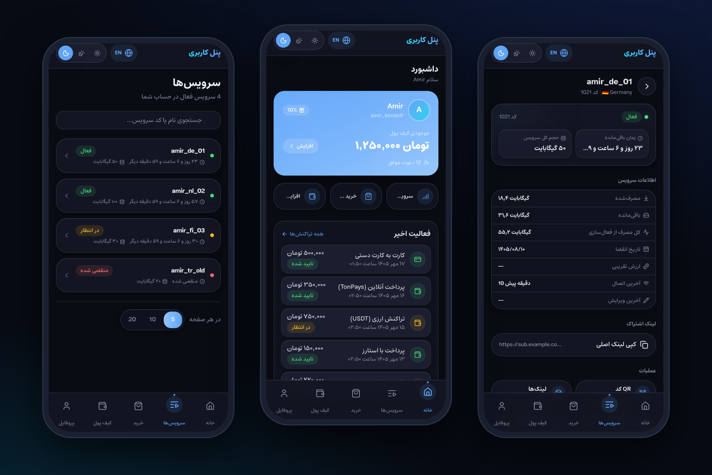
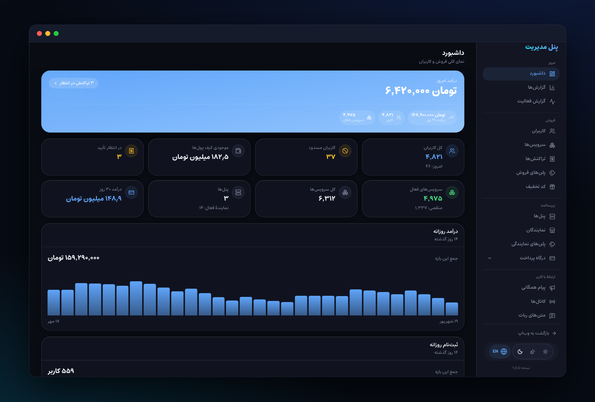

# PasarguardBot

[](https://www.python.org/)
[](LICENSE)
[](https://github.com/LonamiWebs/Telethon)
[](https://amirkenzo.github.io/PasarguardBot/)

ربات فروش وی‌پی‌ان مبتنی بر پنل [پاسارگارد پنل](https://github.com/PasarGuard/panel).

**[مستندات کامل (فارسی)](https://amirkenzo.github.io/PasarguardBot/)**

> [!IMPORTANT]
> **این ربات کاملا رایگان است.** اگر کسی آن را به شما فروخته، کلاهبرداری شده‌اید.
> نسخه رسمی فقط از همین گیت‌هاب و کانال [@CodeByAK](https://t.me/CodeByAK) منتشر می‌شود؛ فروشنده را در کانال گزارش دهید.

## نصب سریع (لینوکس)

```bash
bash <(curl -fsSL https://raw.githubusercontent.com/AmirKenzo/PasarguardBot/main/scripts/pasarguardbot.sh)
```

بعد از نصب: `pasarguardbot`

## وب‌اپ (Telegram Mini App)

یک پنل کاربری وب برای مشتریان (مشاهده سرویس‌ها، تمدید، شارژ کیف پول) در مسیر [`frontend/`](frontend/) قرار دارد. برای راه‌اندازی و بیلد به [`frontend/README.md`](frontend/README.md) مراجعه کنید؛ در بیلد Docker به‌صورت خودکار ساخته می‌شود.

<p align="center">
  
</p>

<p align="center">
  
</p>

## لایسنس

[GNU AGPL-3.0 + Commons Clause](LICENSE)

- استفاده از ربات برای فروش وی‌پی‌ان خودتان **آزاد است**.
- فروش، اجاره یا فروش نصب و هاست خود ربات (با یا بدون تغییر) بدون اجازه کتبی **ممنوع است**.
- نام «PasarguardBot» و لوگو آن بدون اجازه قابل استفاده نیست.
